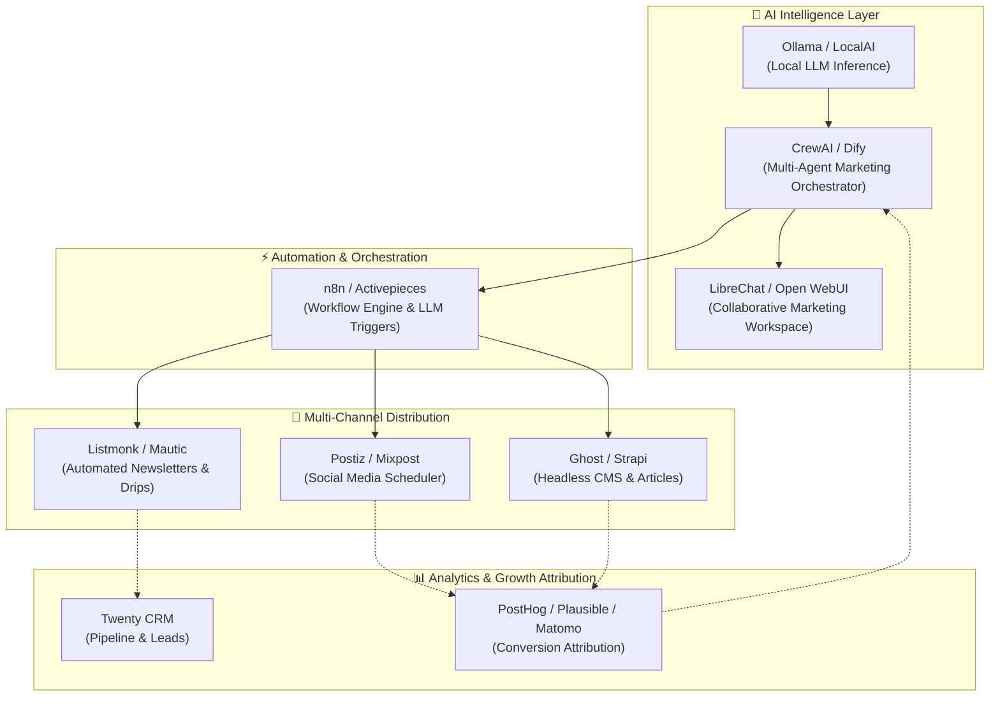

# 🚀 Awesome AI Marketing Assistant

### A Curated Directory of SaaS Platforms & Open-Source LLM Marketing Ecosystems

  
  
  
  
  
  

  <strong>Supercharge your growth engine with cutting-edge AI marketing assistants, autonomous LLM agents, automated copywriting tools, SEO predictors, and self-hosted open-source marketing stacks.</strong>

---

## 📑 Table of Contents

- [🎯 Overview & SEO Highlights](#-overview--seo-highlights)
- [📊 Sector Overview & Market Dynamics](#-sector-overview--market-dynamics)
- [🏢 SaaS & Hosted AI Marketing Platforms](#-saas--hosted-ai-marketing-platforms)
- [💻 Open-Source AI Marketing & Growth Stacks](#-open-source-ai-marketing--growth-stacks)
- [🛠️ Recommended Self-Hosted Marketing Architecture](#️-recommended-self-hosted-marketing-architecture)
- [🤝 How to Contribute](#-how-to-contribute)
- [📈 Star History](#-star-history)
- [💖 Support & Community](#-support--community)
- [⚖️ Disclaimer & Compliance](#️-disclaimer--compliance)

---

## 🎯 Overview & SEO Highlights

**Awesome AI Marketing Assistant** is an authoritative, regularly updated directory tracking the top **AI marketing software**, **generative copywriting assistants**, **automated campaign optimizers**, and **open-source AI growth agents**.

Whether you are a CMO scaling omni-channel campaigns, a growth marketer running multivariate ad copy tests, or an engineer deploying private, self-hosted LLMs for brand voice generation, this repository curates the best commercial platforms and vendor-independent open-source architectures available.

### 🔑 Key Focus Areas
- ✍️ **AI Copywriting & Long-Form Content**: Automated blog drafting, landing page copy, social posts, and ad creative variants.
- 🎯 **Predictive Campaign Performance**: Pre-send conversion rate scoring, emotional resonance analysis, and CTR optimization.
- 🤖 **Autonomous Marketing Agents**: Multi-agent orchestration for competitive research, SERP analysis, and content workflows.
- 🔒 **Data Privacy & Self-Hosting**: Fully sovereign, local LLM-powered marketing automation stacks (CDP, CRM, ESP, and analytics).

---

## 📊 Sector Overview & Market Dynamics

The global **AI in Marketing** market size was estimated at **$25.5 Billion in 2024** and is projected to expand to over **$82.7 Billion by 2030**, advancing at a robust compound annual growth rate (**CAGR of 26.8%**). 

The market dynamics exhibit **moderate fragmentation at the application tier**—with hundreds of specialized AI point solutions competing in ad generation, SEO brief generation, and social media scheduling—alongside **high concentration at the foundational platform layer**, where legacy enterprise suites (such as HubSpot, Salesforce Marketing Cloud, and Adobe Experience Cloud) are aggressively integrating native generative AI assistants to lock in customer relationships and customer data pipelines.

---

## 🏢 SaaS & Hosted AI Marketing Platforms

The table below lists top commercial AI marketing assistants, **sorted in descending order by company scale** (market capitalization / enterprise valuation and annual recurring revenue). Each entry includes verified starting tier pricing and specific free trial / free tier terms.

| 🏢 Platform | 💰 Company Scale (Valuation / Revenue) | 🏷️ Starting Pricing | 🎁 Free Tier / Free Trial Limits | ⚡ Core Marketing Capabilities |
| :--- | :--- | :--- | :--- | :--- |
| **[HubSpot AI](https://www.hubspot.com/)** | **~$30B+ Market Cap** (NYSE: HUBS, $2.1B+ ARR) | **$20/mo** (Marketing Hub Starter, or $15/mo billed annually) | **Free Forever Tier**: Free CRM with AI Content Assistant, up to 500 email sends/month, 1 AI blog post/month, landing pages, and lead forms. | All-in-one conversational CRM, campaign workflows, automated email drafting, predictive lead scoring, and ChatSpot conversational assistant. |
| **[Jasper](https://www.jasper.ai/)** | **$1.5 Billion** (Series A Unicorn; ~$80M ARR) | **$49/mo** (Creator Plan, or $39/mo billed annually) | **7-Day Free Trial**: Full access to 1 seat, unlimited AI words, 1 brand voice, 50+ marketing copywriting templates, and SEO mode. | Enterprise marketing copywriting, multi-brand voice governance, end-to-end campaign asset suites, and Chrome extension integration. |
| **[Copy.ai](https://www.copy.ai/)** | **~$350 Million** ($13.9M raised; ~$20M ARR) | **$49/mo** (Starter Plan, or $36/mo billed annually) | **Free Forever Tier**: 1 user seat, 2,000 words in chat, and 200 bonus workflow credits/month with access to 90+ copywriting tools. | GTM AI platform, multi-step marketing workflows, automated sales outreach sequences, translation, and automated social post creation. |
| **[Anyword](https://anyword.com/)** | **~$180 Million** ($30M+ raised; ~$15M ARR) | **$49/mo** (Starter Plan, or $39/mo billed annually) | **7-Day Free Trial**: 2,500 word generation limit, 1 user seat, access to Predictive Performance Score, and 1 brand voice. | Data-driven performance copywriting with predictive scoring algorithms, audience persona targeting, and website messaging personalization. |
| **[AdCreative.ai](https://www.adcreative.ai/)** | **~$100 Million** (Bootstrapped/Scale; ~$20M ARR) | **$29/mo** (Starter Plan, or $21/mo billed annually) | **7-Day Free Trial**: 10 free AI generation download credits, 1 brand profile, conversion scoring engine, and ad creatives. | AI banner generation, high-CTR display ad creatives, product photoshoots, video ad scripts, and competitor ad intelligence. |
| **[Regie.ai](https://www.regie.ai/)** | **~$80 Million** ($20.8M Series A; ~$8M ARR) | **$59/user/mo** (Pro Plan, or $49/user/mo billed annually) | **Free Forever Tier**: 1 user seat, up to 100 cold outreach/marketing emails generated/month, and native CRM integrations. | Generative AI sales engagement, prospecting sequences, personalized multi-touch outreach campaigns, and inbound lead response agents. |
| **[Writesonic](https://writesonic.com/)** | **~$75 Million** (YC W21; ~$12M ARR) | **$16/mo** (Chatsonic / Individual, or $12/mo billed annually) | **Free Forever Tier**: 25 one-time generation credits (~10,000 words), 1 user seat, and access to Chatsonic research assistant. | AI article writer with real-time web citations, SEO content optimizer, multi-channel ad copy, and customizable knowledge bots. |
| **[Phrasee](https://phrasee.co/)** | **~$65 Million** (Acquired by Capital D; ~$7M ARR) | **$1,500/mo** (Enterprise Tier with dedicated LLM model tuning) | **14-Day Guided Pilot Trial**: 1 custom email subject line / push notification optimization trial on a live brand audience. | Enterprise omnichannel language optimization, email subject line testing, push notification optimization, and brand voice safety guardrails. |
| **[MarketMuse](https://www.marketmuse.com/)** | **~$45 Million** ($8M+ raised; ~$6M ARR) | **$149/mo** (Optimize Plan, or $1,500/yr billed annually) | **Free Forever Tier**: 1 user seat, 10 queries/month, content audit metrics, topic modeling insights, and SERP competitive gap analysis. | AI-driven content strategy, topic modeling, automated content briefs, topical authority mapping, and semantic SEO scoring. |
| **[Hypotenuse AI](https://www.hypotenuse.ai/)** | **~$30 Million** (YC S20; ~$3M ARR) | **$29/mo** (Individual Plan, or $24/mo billed annually) | **7-Day Free Trial**: 15 credits (~3,000 words), batch product description generator, 1 user seat, and Shopify integration preview. | E-commerce product descriptions at scale, bulk catalog copywriting, automated blog drafting, and product image generation. |

---

## 💻 Open-Source AI Marketing & Growth Stacks

Open-source marketing software empowers growth teams to build sovereign, customizable, and cost-effective marketing stacks. Below are the leading open-source repositories, **sorted in descending order by GitHub_Stars**.

Each entry features a live GitHub Stars_Count badge that directly links to the repository's stargazers page.

1. **[n8n](https://github.com/n8n-io/n8n)**   
   Fair-code workflow automation platform with native LangChain & LLM nodes. Build autonomous multi-step marketing automation pipelines connecting CRMs, email tools, social networks, and local/cloud AI models.

2. **[Ollama](https://github.com/ollama/ollama)**   
   Get up and running locally with Llama 3, Mistral, Gemma, and DeepSeek. Provides high-throughput local inference for privacy-preserving marketing copy generation, customer data summarization, and offline drafting.

3. **[Dify](https://github.com/langgenius/dify)**   
   Open-source LLM application development platform. Features visual orchestration, RAG pipelines, and agentic workflows to build custom marketing copilots, customer support agents, and automated content generators.

4. **[Langflow](https://github.com/langflow-ai/langflow)**   
   Visual framework for building multi-agent AI applications and RAG systems. Connect marketing databases, web scrapers, and prompt chains through a drag-and-drop canvas.

5. **[Open WebUI](https://github.com/open-webui/open-webui)**   
   Enterprise-ready, self-hosted web UI for LLMs. Supports OpenAI, Ollama, document RAG, and role-based access control. Provides a collaborative workspace for marketing teams to draft and refine campaign assets.

6. **[Strapi](https://github.com/strapi/strapi)**   
   Leading open-source headless CMS (JavaScript/TypeScript). Serves as the central content repository for omnichannel marketing, easily connected to AI generation agents via REST and GraphQL APIs.

7. **[CrewAI](https://github.com/crewAIInc/crewAI)**   
   Cutting-edge framework for orchestrating role-playing autonomous AI agents. Assign specialized agents for market research, SEO keyword analysis, blog drafting, and social media scheduling to work in concert.

8. **[Twenty](https://github.com/twentyhq/twenty)**   
   Modern, open-source CRM alternative to Salesforce and HubSpot, architected specifically for AI integrations, customer journey tracking, and automated lead management.

9. **[Ghost](https://github.com/TryGhost/Ghost)**   
   Modern open-source publishing and newsletter platform with built-in subscription management, SEO automation, and webhooks for automated AI publishing workflows.

10. **[Flowise](https://github.com/FlowiseAI/Flowise)**   
    Drag-and-drop visual UI to build LLM apps and interactive conversational marketing bots for website lead qualification and product recommendation.

11. **[LocalAI](https://github.com/mudler/LocalAI)**   
    Self-hosted, drop-in replacement REST API compatible with OpenAI specifications. Run text generation, voice transcription, and image generation models on consumer hardware without vendor lock-in.

12. **[LibreChat](https://github.com/LibreChat-AI/LibreChat)**   
    Enhanced AI chat platform featuring multi-model routing (OpenAI, Anthropic, Gemini, local models), agent builders, code interpretation, and file analysis for growth teams.

13. **[PostHog](https://github.com/PostHog/posthog)**   
    Comprehensive open-source product and marketing analytics platform featuring session replays, funnel analysis, feature flags, and A/B testing for data-driven campaign optimization.

14. **[Novu](https://github.com/novuhq/novu)**   
    Open-source notification infrastructure for engineers and marketers. Orchestrate omnichannel customer communication across email, SMS, push, and in-app chat.

15. **[Chatwoot](https://github.com/chatwoot/chatwoot)**   
    Omnichannel customer engagement and live chat platform. Connect website visitors with marketing sales agents and automated AI chatbots.

16. **[Postiz](https://github.com/gitroomhq/postiz-app)**   
    Agentic open-source social media scheduling tool. Features AI-assisted viral post ideation, multi-platform scheduling, and engagement analytics.

17. **[Plausible Analytics](https://github.com/plausible/analytics)**   
    Lightweight, privacy-first web analytics platform. Track marketing campaign referrers, custom conversion goals, and landing page metrics without cookies.

18. **[Activepieces](https://github.com/activepieces/activepieces)**   
    Open-source business automation platform with AI pieces and MCP protocol support. Automate social publishing, lead routing, and content distribution workflows.

19. **[Listmonk](https://github.com/knadh/listmonk)**   
    High-performance, self-hosted newsletter and mailing list manager powered by Go and PostgreSQL. Delivers millions of personalized marketing emails at near-zero infrastructure cost.

20. **[Matomo](https://github.com/matomo-org/matomo)**   
    Leading Google Analytics alternative offering 100% data ownership, marketing attribution modeling, heatmaps, conversion funnels, and tag management.

21. **[Mautic](https://github.com/mautic/mautic)**   
    World's largest open-source marketing automation platform. Manage multi-channel drip campaigns, dynamic lead scoring, contact segmentation, and landing pages.

22. **[Mixpost](https://github.com/inovector/mixpost)**   
    Self-hosted social media management software. Schedule, publish, and analyze social content across X/Twitter, LinkedIn, Facebook, and Instagram from your own servers.

23. **[Helio](https://github.com/achref-soua/helio)**   
    AI-native growth platform unifying customer data platform (CDP), natural-language audience segmentation, and cross-channel marketing journeys on Temporal workflows.

---

## 🛠️ Recommended Self-Hosted Marketing Architecture

By combining best-of-breed open-source tools, growth teams can build an enterprise-grade AI marketing assistant stack that guarantees full data sovereignty:

---

## 🤝 How to Contribute

Contributions are warmly welcomed! Help make this directory the definitive resource for AI marketing technology:

1. 🍴 **Fork the repository** on GitHub.
2. 🌿 **Create a feature branch**: `git checkout -b feature/add-new-marketing-tool`.
3. 📝 **Add your tool**: Ensure SaaS entries include verified starting pricing, company valuation/revenue, and explicit free tier/trial limits. Open-source entries must include license, description, and link to stargazers.
4. 📬 **Submit a Pull Request** with a concise description of why the tool is a valuable addition.

---

## 📈 Star History

---

## 💖 Support & Community

Thank you for visiting and using **Awesome AI Marketing Assistant**! If this curated directory helps you discover marketing tools, optimize campaigns, or design open-source AI workflows, please consider supporting the project:

- ⭐ **Star this repository** to help other marketers, developers, and founders discover it.
- 🍴 **Fork and contribute** your own workflows, tools, and evaluations.
- 📢 **Share the repo** on Twitter/X, LinkedIn, and developer communities.
- ☕ **Sponsor the Maintainer**: Support ongoing curation, updates, and ecosystem research via the [GitHub Sponsor Dashboard](https://github.com/sponsors/ishandutta2007).

  

---

## ⚖️ Disclaimer & Compliance

- **Community Curated**: This repository is a community-maintained resource for educational and informational purposes. Mention of specific vendors or projects does not imply formal endorsement.
- **Regulatory Compliance**: Marketing teams deploying AI-generated copy, imagery, and automation must adhere to applicable regulatory frameworks including FTC guidelines, GDPR, CAN-SPAM, and advertising platform terms of service.
- **Review Guidelines**: Human oversight is strongly advised before publishing AI-generated marketing copy to ensure factual accuracy, legal compliance, and brand alignment.

---

  Made with ❤️ for marketers, growth engineers, and AI developers worldwide.

